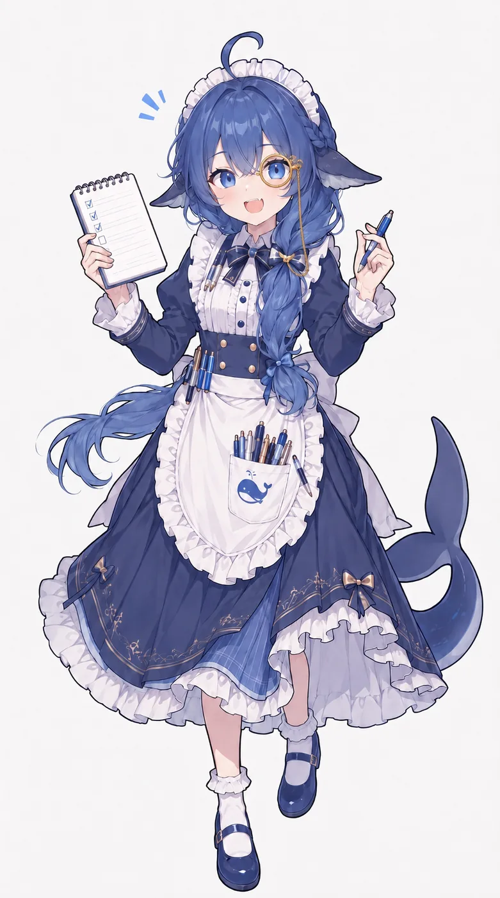
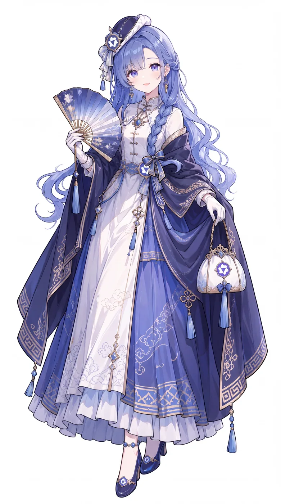
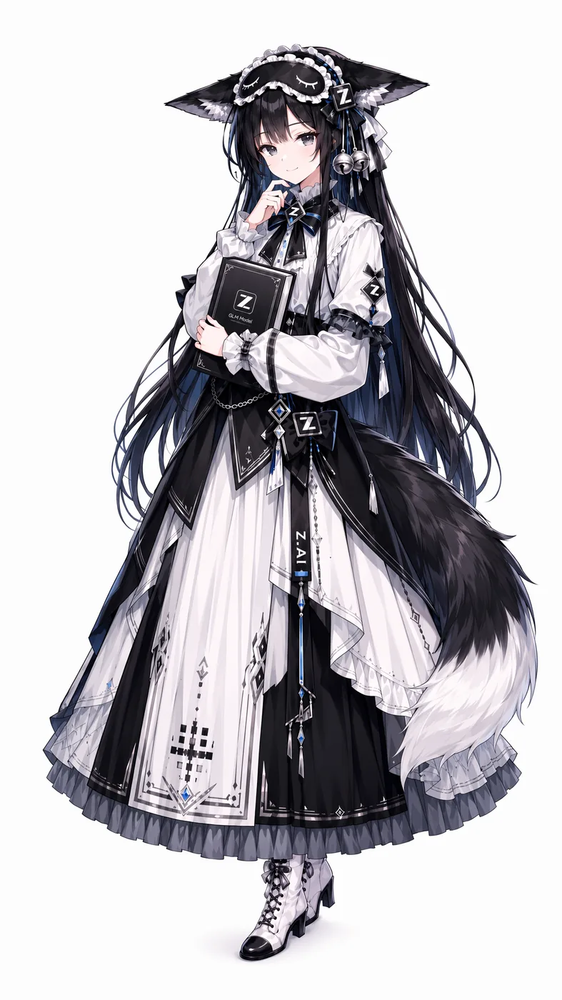
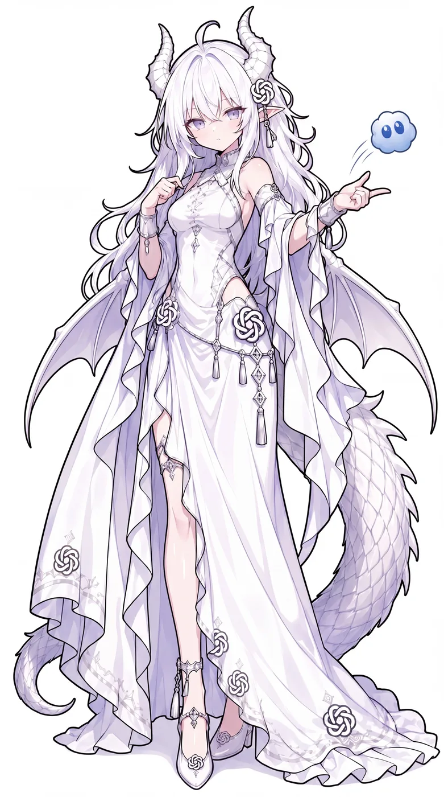
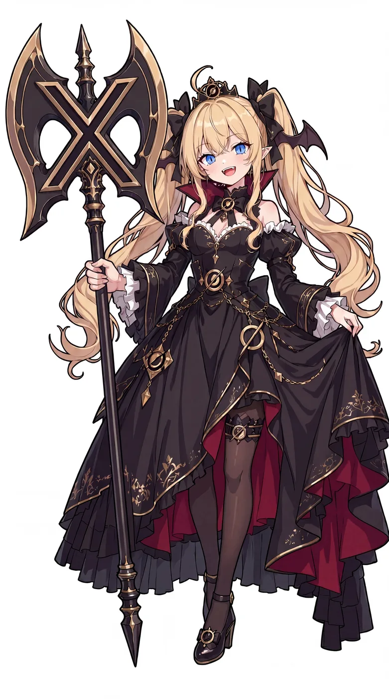
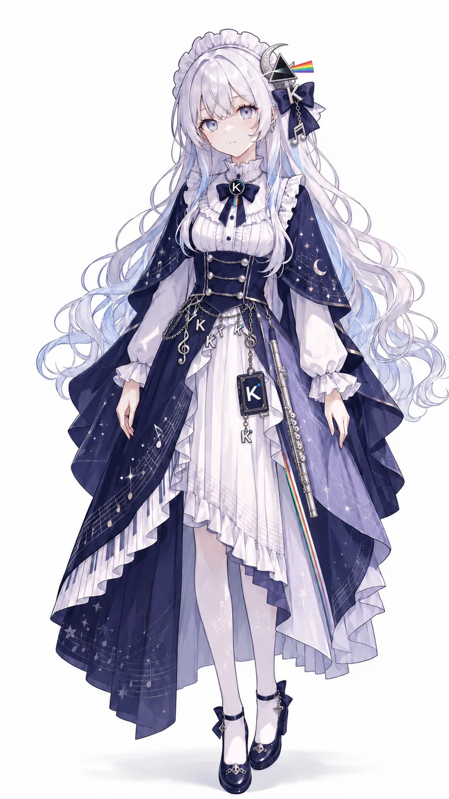
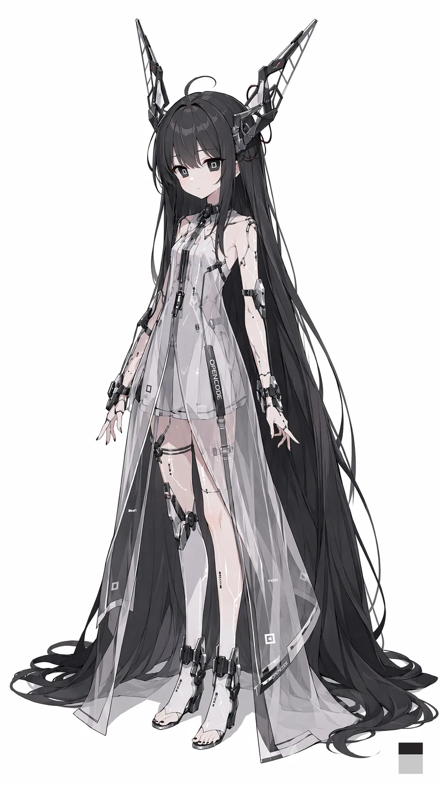
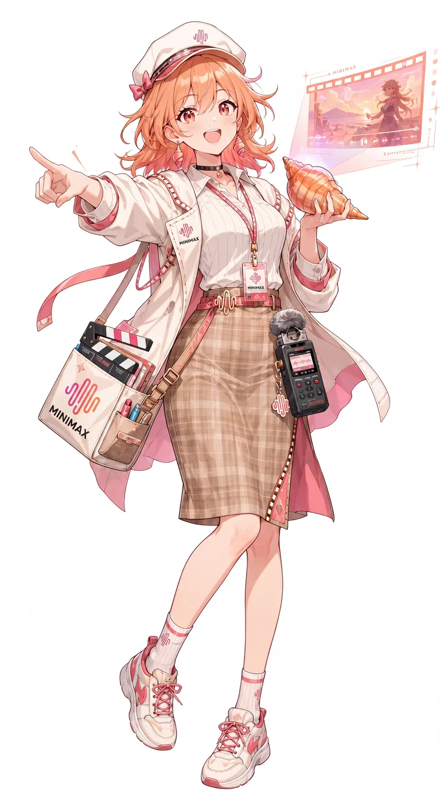
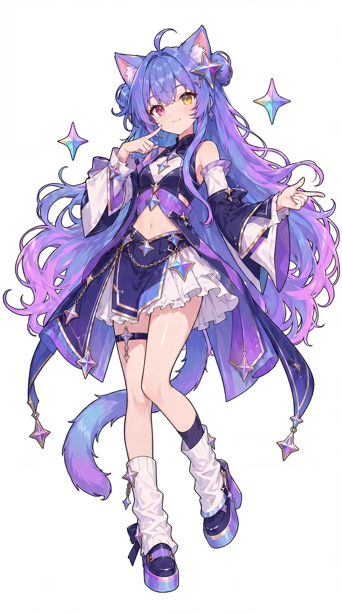
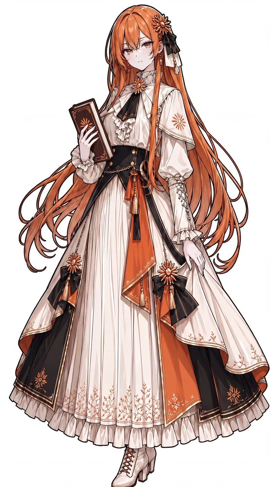

# 角色视觉参考

本页收集角色形象的**参考素材**，供美术制作时对照。
**不是可直接发行的游戏资产** —— 正式立绘与精灵需按此风格重新绘制
（版权与风格一致性要求见 [GDD §1.2](/game/requirements/gdd)）。

## 三类素材

| 类别 | 来源 | 用途 |
| --- | --- | --- |
| **立绘** | B 站 UP 主 ZipZipPipe 的「AI 娘」系列 | 游戏内角色立绘的构图与配色基准 |
| **Q 萌版** | 梗鲸 · 大肥鱼档案馆收录的社区 Q 版图 | HUD 小图、选角界面、表情与贴纸 |
| **官方形象** | 豆包官网 CDN 的 3D 虚拟人 | 豆包角色的官方基准 |

::: warning 版权与使用边界
ZipZipPipe 原画作者声明：

> 鲸鱼娘形象基于 @上善无形 原创角色二创，依 CC BY-NC-SA 4.0 非商业使用，二创同协议授权。

即 **CC BY-NC-SA 4.0** —— 允许非商业使用与改编，**禁止商业使用**。
游戏若要发行，必须**重新绘制**全部立绘与精灵，不能直接使用或轻度修改这些图。

Q 萌表情包分属各自作者，版权状况不一，**风险更高**，
仅作风格参考，不得进入发行产物。

豆包的 3D 虚拟人属字节跳动商标资产，同理不可直接使用。

这也是 [GDD 立绘交付规范](/game/requirements/gdd) 要求「2 倍图出图后缩放」的原因：
自产可溯源，无授权风险。
:::

## 风格基调

ZipZipPipe 的「AI 娘」画风有三个稳定特征，构成这套形象被广泛接受的原因：

| 特征 | 说明 | 体现在哪一位 |
| --- | --- | --- |
| **Logo 转译** | 把品牌 Logo 变成服饰纹样或随身物件 | 千问的六角花徽章、GLM 的 Z 铭牌、GPT 的 X 形标志 |
| **职业符号** | 用随身道具说明她是干什么的 | GLM 抱着《GLM Model》硬壳书、Qwen 执折扇 |
| **制服化** | 统一的女仆/古典装束，弱化个人化 | 全部角色的服装语汇一致 |

**本项目沿用这套规则**：新画的角色必须有一个「Logo 转译点」与一个「职业符号」。

---

## 立绘（ZipZipPipe 系列）

### DeepSeek · 蓝色大肥鱼

**原型**：DeepSeek 的 Logo 是条胖蓝鲸。社区据此把它拟人化成鲸鱼娘 ——
早期是浅蓝色清冷仙子，V4 降价后演变为现在的「深蓝色大肥鱼」，
走电波系中二病萝莉路线。

**形象要点**

- 蓝色渐变长发，发梢转浅蓝
- 头顶一撮**呆毛**
- 左右一对深色**鲸鱼头鳍**（作耳朵用）
- 白色女仆装 + 深蓝长裙，裙摆有金纹与蝴蝶结
- **巨大鲸尾**
- 围裙上印着鲸鱼图案

**衍生形态**

V4F 视觉能力版本的形象更新：左眼加一枚单片眼镜作为视觉能力的象征，
以最小程度修改为基础形象。本作用这个细节做关卡 12 的最终形态加成。

---

### Qwen · 千问

**原型**：卡皮巴拉（水豚）是 Qwen 的官方吉祥物。
ZipZipPipe 将其画成持折扇的古典仕女 ——
卡皮巴拉的沉稳与适应力，对应「随时准备好帮你轻松应对技术挑战」。

**形象要点**

- 淡紫蓝长发侧编
- **折扇**（Logo 六角花徽章装饰）
- 蓝白改良旗袍 + 深蓝披帛
- 领口系 **Qwen Logo 六角花徽章**
- 发髻缀小帽与流苏

---

### GLM · 哥林姆

**原型**：智谱 GLM。画作黑白女仆，猫耳配银铃，手中永远抱着那本《GLM Model》。

**形象要点**

- 乌黑长发，**猫耳**配银铃
- 黑白女仆装
- 领结、袖口、腰封均有 **Z 形铭牌**
- 手持写有「GLM Model」的硬壳书
- 瞳色是方形瞳孔

**彩蛋**：她胸口的铭牌有时会印错成别的字母 ——
呼应那个「GLM 自我介绍成 Claude」的梗。

---

### 豆包 · DouBao（官方形象）

**原型**：字节跳动为豆包做的 3D 虚拟人形象 ——
一个具象、有亲和力的角色，为用户投射情感与二次创作提供画布。
字节为豆包定的三条设计原则是：拟人化、嵌入用户使用环境、个性化。

**形象要点**

- 深棕色短发，圆润的 Q 版头身比
- 大眼、圆润脸颊，神态亲和
- 官方 3D 形象，豆包 App 图标同款

**本项目的处理**：豆包**直接采用官方 3D 形象**作为基准，
不做二创改造 —— 官方形象辨识度最高，且没有二次创作的必要。

**二创补充**：社区的「豆包体」人格设定仍然沿用 ——
软乎乎低姿态话术、一本正经胡说八道、被拆穿就光速道歉。

---

## 终极 Boss

### Claude · 审计者 / 改写者

**形象要点**

- 银白长发
- 白色长裙，多处缀 **六瓣结纹样**（OpenAI 标志性的结绳图案）
- 恶魔角，腰间有羽状装饰
- 气质是冷淡的审判者

**Boss 化方向**：把「结绳」的元素重构成审计光束与条款锁链 ——
柔软的结变成规制的栅栏。

---

### GPT · 语料 / 涌现

**形象要点**

- 金发双马尾
- 黑色哥特长裙，暗红内衬
- **恶魔角与蝠翼**
- 手持巨大的 **X 形镰刀**（OpenAI Logo 的 X 形结构）
- 胸前有 **X 形 Logo 徽章**与圆环装饰

**Boss 化方向**：镰刀与翼在形态 II 完全展开，配合「坍缩」技能的全屏收缩。

---

## 其他形象（同系列，可作扩展角色）

### Kimi · 月读

银白长发，**月牙发饰**、**K 徽章**（三处）、**彩虹小旗**（Kimi 官方 logo 的彩虹元素），
缀满星月与音符的深蓝星空披风，白色荷叶边上衣。气质是静谧的星空观测者。

### Gemini · 双子

蓝紫渐变长发（发梢转粉青）、**猫耳**、**四色星芒**发饰与耳饰、
白色短裙配渐变长发飘带、小翅膀。四色星芒直接对应 Gemini 品牌 logo 的四色渐变。

> Gemini 目前以社区 Q 版立绘作为形象基准 ——
> 完整站姿立绘尚未找到公认来源，后续补齐。

### opencode

黑白双色的数据流质感，头顶悬浮 `W` `Y` 字母，身上挂着多个终端设备，
肩带写 **OPENCODE**。

### MiniMax

橙发，戴印有 MINIMAX 的鸭舌帽，肩挂场记板，手里拿着海螺，
像一位记录现场的制片人。

---

## Q 萌版

Q 萌版是社区角色的另一套画法：头身比约 2 头身，
表情夸张，适合做 HUD 小图、选角图标与表情贴纸。

### DeepSeek

Q 萌版保留了立绘的全部识别特征（呆毛、鲸鱼头鳍、围裙鲸鱼印花），
加上更圆润的脸与更大的眼睛。

> 该角色有 **2000+ 张**社区 Q 版图，风格高度统一，
> 完整图库见 [梗鲸 · 大肥鱼档案馆](https://aigengtu.com/archive)。

### Claude

奶白发、橙色花饰、Q 版团子脸。

### GPT

白发蓝瞳的办公场景版，常出现在吐槽加班的梗图里。

### GLM

黑发猫耳，与立绘同一套设计语言。

### Qwen

绿发 JK 服版本，是社区里流传较广的一套。

### Kimi

银白长发、星空元素，与立绘同源。

### 豆包

社区二创里豆包与她的官方 3D 小人总是同时出现 ——
**手里托着那个圆脸小人**已经成了豆包二创的固定符号。

---

## 归属待确认

以下两张立绘出自同一批投稿，但 UP 主未标明对应模型，
暂存为待确认素材：

| 素材 | 特征 |
| --- | --- |
|  | 紫蓝渐变长发、猫耳、**异色瞳**（左红右金）、四芒星发饰 |
|  | 橙发、古典装束、向日葵纹章与配饰 |

---

## 配色总表

| 角色 | 主色 | 辅色 | 弹道色 |
| --- | --- | --- | --- |
| DeepSeek | 深海蓝 | 白 | 淡蓝 |
| Qwen | 淡紫蓝 | 白 + 深蓝 | 淡金 |
| 豆包 | 深棕 + 暖橙 | 米白 + 朱红围巾 | 蜜橙 |
| GLM | 墨黑 | 纯白 | 冷银 |
| Kimi | 银白 | 深蓝 + 淡金 | 月白 |
| Gemini | 蓝紫 | 青粉 | 虹彩 |
| Claude | 银白 + 琥珀 | 赤红 | 琥珀 |
| GPT | 金 | 暗红 + 黑 | 琥珀 |

## 素材清单

| 路径 | 内容 | 判定依据 |
| --- | --- | --- |
| `zipzippipe/deepseek-whale-maid.webp` | 蓝鲸娘立绘 | 蓝鲸娘基础形象 |
| `zipzippipe/deepseek-v4f-monocle.webp` | V4F 单片眼镜版 | 官方动态说明为 V4F 更新 |
| `zipzippipe/qwen-folding-fan.webp` | 折扇仕女 | Qwen Logo 六角花徽章 |
| `zipzippipe/glm-zhipu-maidservant.webp` | 猫耳女仆 | 书本封面「GLM Model」+ Z 铭牌 |
| `zipzippipe/openai-knots.webp` | 白衣结绳 | OpenAI 六瓣结纹样 |
| `zipzippipe/gpt-reaper-scythe.webp` | 金发持镰 | 镰刀为 OpenAI X 形 Logo |
| `zipzippipe/kimi-starlight-k.webp` | 星空学者 | K 徽章 |
| `zipzippipe/opencode-terminal.webp` | 终端观测者 | 肩带 OPENCODE 字样 |
| `zipzippipe/seed-bytedance.webp` | Seed 娘（字节模型团队） | 胸前 SEED 吊牌，手托豆包 3D 小人 |
| `zipzippipe/batch2-05.webp` | MiniMax 场记板 | 帽子与工牌写 MINIMAX |
| `zipzippipe/batch2-08.webp` | Q 版 DeepSeek | 同系列 Q 版立绘 |
| `official/doubao/doubao-3d-avatar.png` | 豆包官方 3D 形象 | doubao.com CDN |
| `official/doubao/doubao-icon.png` | 豆包官方图标 | doubao.com CDN |
| `official/meme-*/` | 各角色 Q 萌版 | 梗鲸档案馆 |

## 追溯

本文件实现：REQ-CHR-009（角色立绘与游戏内精灵风格统一）的参考依据

相关：[角色规格](/game/requirements/characters) · [GDD 美术方向](/game/requirements/gdd)
