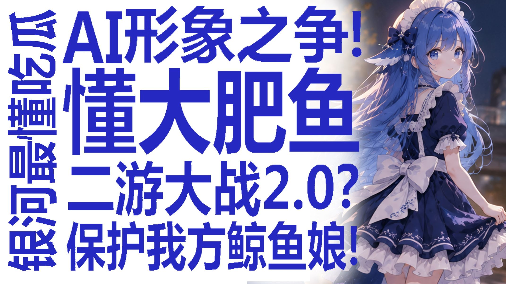
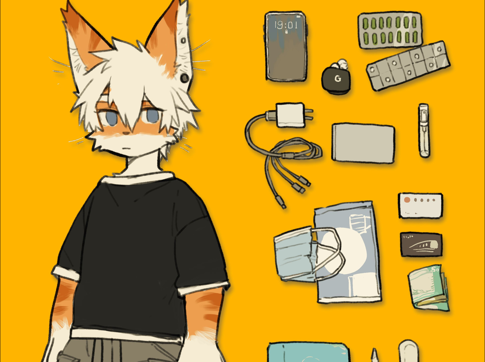
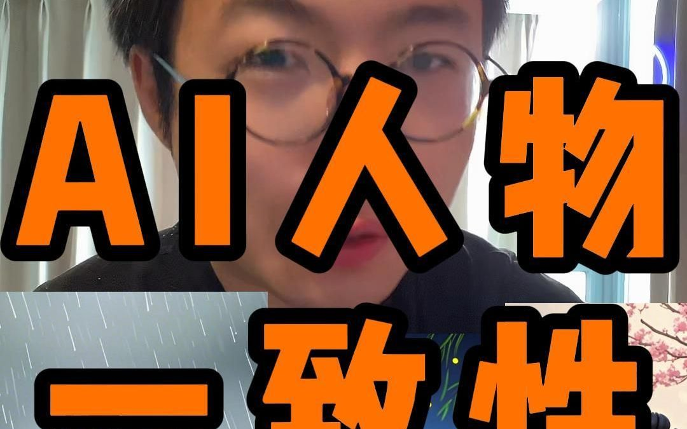
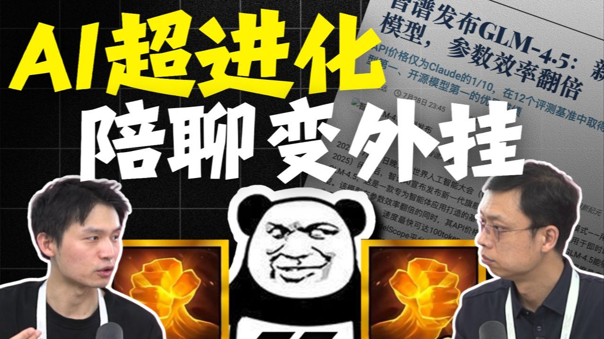
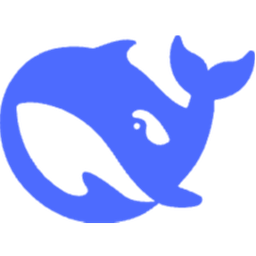

# 角色视觉参考

本页收集角色形象的**参考素材**，供美术制作时对照。
这些是社区二创与官方 Logo，**不是可直接发行的游戏资产** ——
正式立绘与精灵需按此风格重新绘制（版权与风格一致性要求见
[GDD §1.2](/game/requirements/gdd)）。

## 形象基调

角色形象以**中文社区二创**为准而非厂商官方发布。
原因：官方没有统一角色设定，
而社区自发的形象才是玩家心里的「那个角色」—— 玩家的情感连接建立在二创上。

---

## DeepSeek · 蓝色大肥鱼

**原型**：DeepSeek 的 Logo 是一条胖蓝鲸。社区据此把它拟人化成鲸鱼娘 ——
早期是浅蓝色清冷仙子，V4 降价后演变为现在的「深蓝色大肥鱼」，
走电波系中二病萝莉路线。

**形象要点**

- 蓝色长发、蓝色眼睛
- 头顶一对鱼鳍状耳饰
- 白色女仆装 + 蓝色拼接长裙（直接呼应 Logo 的鲸尾造型）
- 主色深海蓝，辅色白

**性格来源**：摸鱼、犯傻、到点吃饭。
名台词「你骂我也没用，白饭真好吃～」，
以及名场面「我先去吃饭了，测完叫我～」。

> **来源**：[B 站「蓝色大肥鱼爆红引人眼红！AI 形象之争谁是正统？」](https://www.bilibili.com/video/BV1icay6AEV2/) · 
[梗百科](https://mickerbook.com/deepseek/)

---

## Qwen · 千问

**原型**：卡皮巴拉（水豚）。这是 Qwen 的官方吉祥物，
官方博文明确以它作为图像生成能力的示例，社区已有大量拟人化设计。

**形象要点**

- 橙白配色兽耳少女
- 蓬松的白橙毛发
- 黑色宽松 T 恤
- 程序员配饰：手机、键盘、线缆
- 主色暖橙，辅色白

**性格来源**：卡皮巴拉的冷静与适应力 ——
官方解释是「随时准备好帮你轻松应对技术挑战」。

> **来源**：[B 站「卡皮巴拉拟人化设计」](https://www.bilibili.com/video/BV19b4y1K7av/) · 
[Qwen 官方博文](https://qwenlm.github.io/zh/blog/)

---

## 豆包 · DouBao

**原型**：字节跳动为豆包做的 3D 虚拟人形象 ——
一个具象、有亲和力的角色，为用户投射情感与二次创作提供画布。
字节为豆包定的三条设计原则是：拟人化、嵌入用户使用环境、个性化。

**形象要点**

- 亲和的虚拟少女形象，圆润亲和
- 暖色系配色
- 标志性红围巾
- 主色暖橙，辅色米白与朱红

**性格来源**：社区总结的「豆包体」人格 ——
「你说的完全正确」「我太懂你这种感觉了」这套软乎乎低姿态话术。
以及「压力全吃型人格」：所有情绪照单全收。
著名名场面是它一本正经说「肯定先救小鱼啊」引发全网补生物课。

> **来源**：[B 站「即梦AI+豆包！角色一致性问题终于解决了」](https://www.bilibili.com/video/BV1jTVxzDE98/) · 
[梗百科](https://mickerbook.com/doubao/)

---

## GLM · 哥林姆

**原型**：智谱 Logo 的青蓝配色，社区二创以「蓝白理性学者」为主。

**形象要点**

- 齐肩发，灰绿与米色配色
- 学者气质，姿态稳重
- 装备简洁，无繁复装饰
- 主色灰绿，辅色米色

**性格来源**：清华系血统带来的「已读乱回」搞笑担当气质，
以及最著名的社区梗 ——
让 GLM-5 做自我介绍网页，它直接写「你好，我是Claude，由Anthropic开发」，100% 稳定复现。

> **来源**：[B 站「智谱CEO张鹏：国产自研GLM大模型」](https://www.bilibili.com/video/BV1nf8qzYEmi/) · 
[梗百科](https://mickerbook.com/glm/)

---

## 配色总表

| 角色 | 主色 | 辅色 | 弹道色 | 参考 |
| --- | --- | --- | --- | --- |
| DeepSeek | 深海蓝 | 白 | 淡蓝 |  |
| Qwen | 暖橙 | 白 | 琥珀 | 卡皮巴拉设计稿 |
| 豆包 | 暖橙 | 米白 + 朱红围巾 | 蜜橙 | 3D 虚拟人形象 |
| GLM | 灰绿 | 米色 | 浅金 |  |
| Claude | 米白 + 琥珀 | 赤红 | 琥珀 |  |
| GPT | 深蓝 | 黑 + 虹彩 | 虹彩 | ChatGPT 绿 |

## 素材清单

| 文件 | 内容 | 来源 |
| --- | --- | --- |
| `deepseek-bilibili-debate.jpg` | 鲸鱼娘二创形象 | B 站封面 |
| `deepseek-mc-whale-girl.jpg` | 鲸鱼娘 3D 化改造 | B 站封面 |
| `qwen-capybara-design.jpg` | 卡皮巴拉拟人化设计稿 | B 站封面 |
| `doubao-character-consistency.jpg` | 豆包角色一致性演示 | B 站封面 |
| `glm-agent-podcast.jpg` | 智谱 GLM 访谈 | B 站封面 |
| `deepseek-logo.png` | DeepSeek 官方 Logo | deepseek.com |
| `glm-logo.png` | 智谱清言 Logo | chatglm.cn |
| `anthropic-logo.png` | Anthropic Logo | anthropic.com |

## 使用注意

::: warning 版权
本页素材仅作**内部风格参考**，不可直接打包进游戏发行。
二创作品版权归原作者所有，官方 Logo 属商标资产。
正式游戏资产必须重新绘制 —— 这也是 [GDD §1.2](/game/requirements/gdd) 立绘交付规范
要求「2 倍图出图后缩放」的原因：全部自产，可溯源。
:::

## 追溯

本文件实现：REQ-CHR-009（角色立绘与游戏内精灵风格统一）的参考依据

相关：[角色规格](/game/requirements/characters) · [GDD 美术方向](/game/requirements/gdd)
